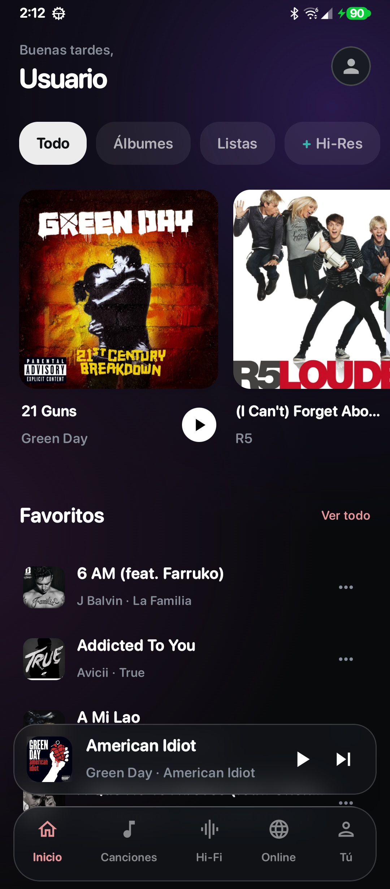
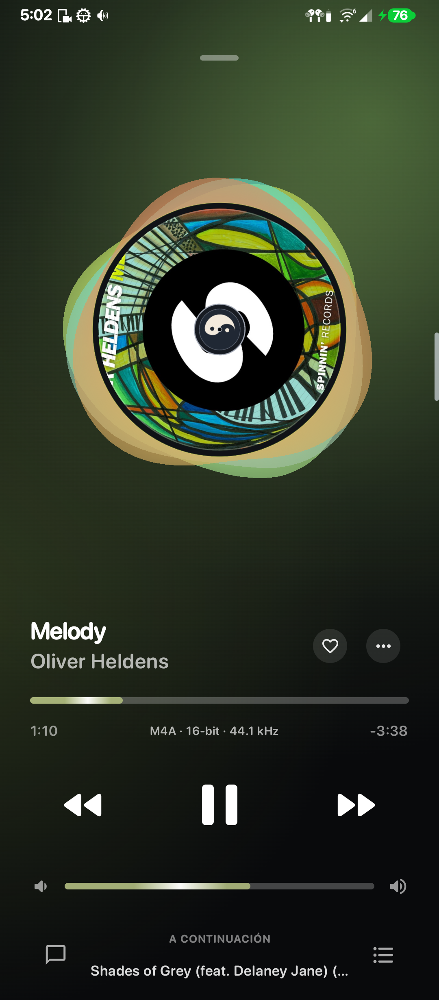
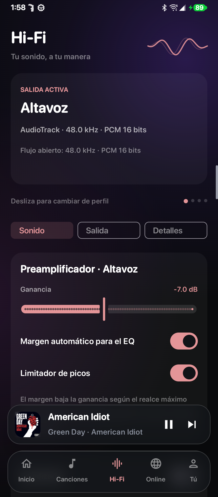
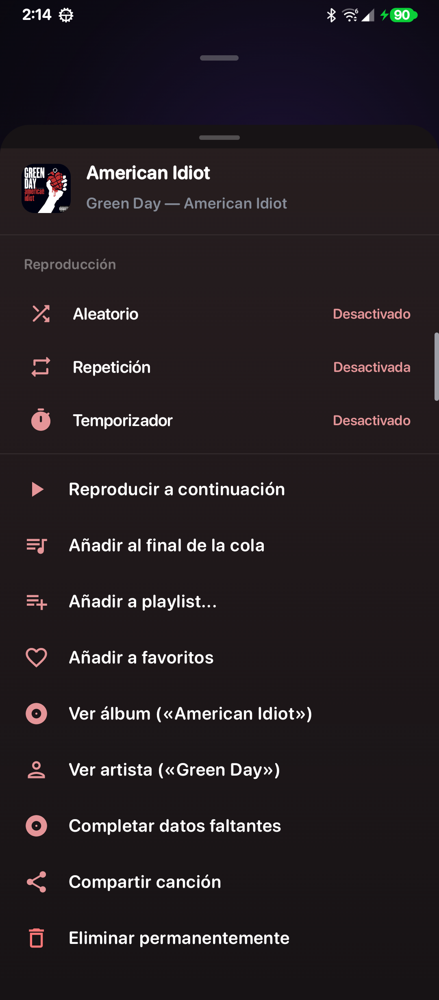

<p align="center"></p>
<h1 align="center">Yang Player</h1>
<p align="center">Tu biblioteca, tus portadas y tu sonido.</p>
<p align="center"><b>Android 8.0+ · Kotlin · Jetpack Compose · Media3 · Motor nativo en C</b></p>
<p align="center"><a href="https://github.com/zXer0z/Yin-Control">Conoce Yin Control</a> · <a href="#compilar">Compilar</a> · <a href="docs/audio-engine.md">Motor de audio</a></p>

Yang es un reproductor Android para escuchar y organizar música local, con una interfaz que toma sus colores de la carátula. Y puede delegar el audio en **[Yin Control](https://github.com/zXer0z/Yin-Control)** cuando ese motor está disponible y autorizado.

## Así se ve

Las portadas musicales pertenecen a sus respectivos titulares; no se distribuyen canciones en este repositorio.

<table><tr><th>Inicio</th><th>Reproductor</th><th>HiFi</th></tr>
<tr><td></td><td></td><td></td></tr></table>

<details><summary>Menú de reproducción</summary>
<p></p>
</details>

## Qué puedes hacer

- Explorar canciones, álbumes, artistas, carpetas, favoritos y playlists locales.
- Cambiar de canción deslizando la portada, ordenar la cola y recuperar la última sesión sin iniciar audio automáticamente.
- Leer letras integradas o importadas; buscar letras sincronizadas en LRCLIB.
- Completar datos o carátulas faltantes con una coincidencia revisada. Los complementos se guardan en Yang y conservan los archivos originales.
- Ver un extracto de Wikipedia sobre álbumes y artistas, con enlace a la fuente y caché local.
- Usar aleatorio, repetir cola/canción y programar una pausa por minutos o al terminar la pista, desde los tres puntos del player.
- Consultar estadísticas locales de tiempo de escucha, canciones y artistas.
- Buscar y reproducir audio online mediante NewPipeExtractor y conectar una cuenta de YouTube Music para el perfil y el catálogo personal.
- Eliminar un archivo de audio permanentemente con confirmación de Android y actualizar sus referencias en la biblioteca.

## Tu sonido

**Sonido, Salida y Detalles** agrupan los controles de HiFi. El carrusel selecciona el perfil de Altavoz, Bluetooth, Jack/AUX o USB que quieres editar, indicando cuál es la conexión activa.

- EQ de diez bandas con frecuencia, ganancia y Q; preamplificador, margen automático y limitador.
- AudioTrack, AAudio y OpenSL ES; Yang Hi-Res solicita AAudio exclusivo y negocia una alternativa compatible si no está disponible.
- Formato PCM, frecuencia y búfer por perfil; telemetría que distingue el formato solicitado del flujo abierto.
- Si Yin administra la reproducción, Yang muestra su estado y ofrece acceso a sus controles.

El formato abierto no demuestra el formato interno del DAC ni el códec Bluetooth. No se anuncia bit-perfect. La onda de cabecera es una animación de reproducción, no un analizador de señal.

## Compilar

Cada repositorio se compila por separado; Yang no necesita el código de Yin para usar su motor local.

**Requisitos:** JDK 17, Android SDK 36, Build Tools 36.0.0 y NDK r27c (`27.2.12479018`). El Gradle Wrapper incluido usa Gradle 8.9. Configura `JAVA_HOME` y la ubicación del SDK mediante `ANDROID_HOME` o un `local.properties` propio.

```powershell
git clone https://github.com/zXer0z/Yang-Player.git
cd Yang-Player
./tools/Prepare-DebugSigning.ps1
# Si no tienes el NDK instalado en el SDK:
./tools/Fetch-Ndk.ps1
./gradlew.bat :app:assembleRelease --console=plain
```

APK: `app/build/outputs/apk/release/app-release.apk`. También se incluye `gradlew` para sistemas Unix. Un NDK ya existente puede indicarse con `-PndkPath=RUTA_AL_NDK`.

La configuración pública firma los builds de desarrollo con el keystore estándar de Android de tu equipo. El script prepara uno si falta; **no se publica ninguna clave privada**. Para conectar builds propios de Yang y Yin, compila ambos con ese mismo keystore. Si usas firmas distintas, pasa a Yang `-PyinCertSha256=HUELLA_SHA256_DE_YIN` y a Yin `-PyangCertSha256=HUELLA_SHA256_DE_YANG`. El puente comprueba los certificados en ambas direcciones. Un APK firmado con otra clave no puede actualizar una instalación existente con distinta firma.

## Arquitectura y documentación

| Pieza | Responsabilidad |
|---|---|
| `ui/` | Pantallas Compose, player, cola y biblioteca |
| `player/` | MediaSession, sesión, temporizador y registro de escucha |
| `audio/` + `cpp/` | Procesamiento PCM y backends de salida |
| `data/` + `lyrics/` | Biblioteca, metadatos, Wikipedia, historial y letras |
| `online/` | Catálogo, cuenta y reproducción online |
| `shared/yin-bridge/` | Protocolo compartido de comunicación con Yin |

[Motor de audio](docs/audio-engine.md) · [Puente con Yin](docs/yin-bridge.md) · [Metadatos y letras](docs/metadata-completion.md) · [Funciones de reproducción](docs/library-features.md).

El historial de escucha se guarda en el dispositivo. Las funciones online consultan sus proveedores correspondientes; no se suben archivos de música para buscar metadatos. Las capacidades de decodificación dependen de los códecs disponibles: este motor local no incluye una extensión FFmpeg de Media3.

## Estado del proyecto

Proyecto en desarrollo, usado en un LG V60. La compilación release usa R8; las comprobaciones funcionales y de escucha se realizan manualmente en el teléfono. La compatibilidad con cada ruta de audio depende de Android, del dispositivo y de su implementación de audio.

## Licencias y créditos

La aplicación combinada conserva la licencia **GPL-3.0-or-later** declarada por el proyecto y NewPipeExtractor; consulta [LICENSE](LICENSE) y [los avisos incluidos](app/src/main/assets/licenses/NewPipe-NOTICES.md). Las dependencias conservan sus propias licencias. Los JAR usados están en `app/libs` y sus huellas en [dependency-sha256.json](docs/dependency-sha256.json).

Wikipedia conserva su atribución y CC BY-SA 4.0 en los extractos. LRCLIB proporciona las búsquedas de letras; el catálogo de Apple, las coincidencias de metadatos. La integración de YouTube es **no oficial**, mediante NewPipeExtractor; Yang no está afiliado con esos servicios.
